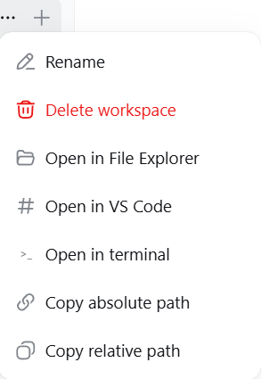

# dsh-workspace-launcher

Open your DeepSeek Harness (dsh) workspace folder in the system file manager, VS Code, or a terminal — and copy its path — straight from the workspace row menu in the sidebar.

> **国内镜像 / Mirror**: also hosted on [gitee.com/chill109/dsh-workspace-launcher](https://gitee.com/chill109/dsh-workspace-launcher) — Gitee is a mainland-China Git host (faster access from mainland China; use it if GitHub is slow).

| | |
|---|---|
| **Platform** | Windows-first (`explorer.exe`); macOS / Linux best-effort |
| **Requires** | DeepSeek Harness `dsh web` (0.1.0-rc.6 profile layout) |
| **License** | MIT (add a `LICENSE` file before publishing) |

> 中文版见 [README.zh.md](README.zh.md)。

---

# Part 1 — If you are a human

*This part is written for people who just want to install and use the plugin.*

## What it does

After installing, hover any workspace in the **sidebar → Workspaces** list, click the **"..."** menu, and you get five new actions:

- 📁 **Open in File Explorer** — reveal the workspace folder in Windows Explorer (Finder / `xdg-open` elsewhere)
- 🖥 **Open in VS Code** — `code <workspace>`
- `>_` **Open in terminal** — a terminal window rooted at the workspace (Windows Terminal, falling back to PowerShell)
- 🔗 **Copy absolute path** — e.g. `D:\qwen-mm-plugins`
- 📋 **Copy relative path** — the workspace folder name relative to its parent (e.g. `qwen-mm-plugins`); a toast confirms "Copied"

No more hunting through the filesystem to find where your workspace lives — one click opens it.

## Screenshot



As shown above: hover a workspace in the sidebar, click the **"..."** at the end of the row, and this plugin adds five actions — **Open in File Explorer** (the default), **Open in VS Code**, **Open in terminal**, **Copy absolute path**, **Copy relative path**. Every action shows a result toast in the bottom-right corner (success/failure), so nothing fails silently.

## Requirements

- Windows 10/11 (primary); macOS/Linux partially supported (file-manager open + terminal; VS Code requires an install — the plugin probes the `code` CLI and the standard install paths automatically)
- DeepSeek Harness web UI running (`dsh web --host 127.0.0.1 --port 3080`)
- `git` optional (used for the cleanest patch path; a built-in fallback exists)

## Manual deployment (Windows)

1. **Copy the plugin package**

   ```powershell
   Copy-Item -Recurse .\plugin\dsh-workspace-launcher "$env:USERPROFILE\.dsh\profiles\node_modules\"
   ```

2. **Patch the workspace client bundle**

   ```powershell
   cd "$env:USERPROFILE\.dsh\profiles\node_modules\@deepseek-ai\dsh-client-ui-workspace\lib"
   git -c core.autocrlf=false apply --unsafe-paths --directory="$PWD" ..\..\..\..\..\..\dsh-workspace-launcher\patch\dsh-client-ui-workspace.patch
   ```

   (If `git` is unavailable, run `.\install.ps1` which applies the same changes with a built-in fallback.)

3. **Register the plugin** — append to `%USERPROFILE%\.dsh\profiles\web\cordis.patch.yml`:

   ```yaml
   - insert:
       - id: workspace-open
         name: 'dsh-workspace-launcher'
   ```

4. **Restart the harness** — close the *DeepSeek Harness Server* window and run `start-dsh.bat` (or restart the `dsh web` process), then **hard-refresh the browser (Ctrl+F5)**.

   > Why a hard refresh: dsh serves each client bundle with a content hash; the browser must re-fetch after the bundle changes.

### One-command alternative

```powershell
.\install.ps1          # installs everything and restarts the harness
```

## Let an AI deploy it

Copy/paste this whole paragraph into your AI assistant (any coding agent that can run shell commands):

> Deploy the dsh-workspace-launcher plugin from `https://github.com/chou109/dsh-workspace-launcher` (mainland-China mirror: `https://gitee.com/chill109/dsh-workspace-launcher`) to my local DeepSeek Harness web profile.
> 1) Run `.\install.ps1` (Windows) — or follow `install.sh` on macOS/Linux — from the repo root. It copies the plugin package into `%USERPROFILE%\.dsh\profiles\node_modules`, patches `@deepseek-ai/dsh-client-ui-workspace`'s client bundle (adding the workspace row menu entries), and registers the plugin in `profiles\web\cordis.patch.yml`.
> 2) If you cannot run the scripts, follow the README "For AI" deployment section exactly (copy files, apply `patch/dsh-client-ui-workspace.patch` with `git -c core.autocrlf=false apply`, append the cordis insert, restart the harness).
> 3) After the harness is back, verify: `Invoke-RestMethod -Uri http://127.0.0.1:3080/workspace-open/open -Method Post -ContentType 'application/json' -Body '{"path":"D:\\","app":"explorer"}'` returns `{"ok":true}` and a File Explorer window opens. Then tell me to hard-refresh the browser.

## Usage

1. Hover a workspace in the sidebar (with a real folder — "Ungrouped" has no path and shows no open actions).
2. Click **"..."** on the row.
3. Pick an action. Explorer opens the folder; copy actions toast "已复制/Copied".

## Uninstall

```powershell
.\install.ps1 -Uninstall
```

or manually: delete `profiles\node_modules\dsh-workspace-launcher`, remove the `workspace-open` insert from `cordis.patch.yml`, and reverse the patch (`git apply -R`) or reinstall `@deepseek-ai/dsh-client-ui-workspace@0.1.0-rc.6`. Then restart the harness.

---

# Part 2 — If you are an AI

*This part is written for AI agents that install, debug, or extend this plugin. It assumes you can run shell commands on the target machine and can read the dsh source packages in `node_modules`.*

## What this is (facts)

A DeepSeek Harness web-profile plugin that adds "open / copy" actions for workspace folders:

- **Host half** — `plugin/dsh-workspace-launcher/lib/index.js`, a cordis plugin exposing `POST /workspace-open/open` `{ path, app: "explorer" | "vscode" | "terminal" }`. It spawns detached, stdio-ignored processes (`explorer.exe` / `code` / Windows Terminal→PowerShell fallback) and validates that `path` is absolute (relative paths → HTTP 400).
- **Client half** — `plugin/dsh-workspace-launcher/lib/client.js` declares `dsh.client` so the package stays a valid client-module entry, but registers no UI.
- **UI patch** — `patch/dsh-client-ui-workspace.patch` (5 hunks) edits `@deepseek-ai/dsh-client-ui-workspace/lib/client.js`: it injects 5 items into the hardcoded `workspaceMenuItems` of `ProjectRowItem` (the sidebar workspace "..." menu), wires `onSelect` to `fetch("/workspace-open/open")` / `writeClipboard`, adds a `showNotice()` toast, and adds 8 locale keys (zh+en).

**Why a patch and not a pure plugin?** The workspace row "..." menu is hardcoded in the shipped `dsh-client-ui-workspace` client bundle; there is no slot to inject menu items (verified: the slot catalog has `sidebar.workspaces` as a single-occupant slot for the whole browser, not per-row). Editing the bundle is the supported pattern here because dsh serves client bundles at runtime from disk — no rebuild, no republish.

## Deployment (exact steps)

### 1. Install the plugin package

```powershell
$profiles = "$env:USERPROFILE\.dsh\profiles"          # or $env:DSH_HOME\profiles
Copy-Item -Recurse plugin\dsh-workspace-launcher "$profiles\node_modules\"
```

### 2. Patch the workspace client

```powershell
$dir = "$profiles\node_modules\@deepseek-ai\dsh-client-ui-workspace\lib"
git -c core.autocrlf=false apply --unsafe-paths --directory="$dir" patch\dsh-client-ui-workspace.patch
```

- The patch targets `client.js` with `a/client.js`/`b/client.js` headers; run it from the repo root.
- **Line endings**: the bundle is LF-only. `-c core.autocrlf=false` is mandatory on Windows or git rewrites the file to CRLF (breaks the served bundle hash semantics — actually just makes a noisier diff; still runs, but keep it clean).
- **Version pin**: the patch context is exact for `@deepseek-ai/dsh-client-ui-workspace@0.1.0-rc.6`. If `git apply` fails, the installed version differs — re-download the pristine file (`npm pack @deepseek-ai/dsh-client-ui-workspace@0.1.0-rc.6`) and re-diff, or use `install.ps1`'s literal fallback (it aborts loudly on anchor mismatch).
- **Idempotency**: `install.ps1` skips patching if the marker `dsh-workspace-open: reveal the workspace folder` is already present.

### 3. Register in cordis

Append to `$profiles\web\cordis.patch.yml` (skip if `dsh-workspace-launcher` already present):

```yaml
- insert:
    - id: workspace-open
      name: 'dsh-workspace-launcher'
```

### 4. Restart + refresh

Kill the `dsh web` node process tree (also reaps the MCP server children; they respawn on boot) and start it again — e.g. rerun `start-dsh.bat`. Then the browser must hard-refresh: the boot manifest (`window.__DSH_BOOT__`) carries per-bundle content hashes; client-modules hashes are live-updated by the HMR watcher, but an already-open page keeps its old bundle until reload.

## Verification (do this after deploy)

```powershell
# 1. host endpoint lives
Invoke-RestMethod -Uri http://127.0.0.1:3080/workspace-open/open -Method Post `
  -ContentType 'application/json' -Body '{"path":"D:\\","app":"explorer"}'
# -> {"ok":true} and an Explorer window opens

# 2. guard: relative path rejected
Invoke-WebRequest -Uri http://127.0.0.1:3080/workspace-open/open -Method Post `
  -ContentType 'application/json' -Body '{"path":"relative","app":"explorer"}' -UseBasicParsing
# -> HTTP 400

# 3. patched bundle is served
(Invoke-WebRequest http://127.0.0.1:3080/plugins/@deepseek-ai/dsh-client-ui-workspace/client.js).Content.Contains('open-explorer')
# -> True

# 4. boot manifest hash matches the file (browser will fetch the new bundle)
$html = (Invoke-WebRequest http://127.0.0.1:3080/).Content
# compare window.__DSH_BOOT__ rev for dsh-client-ui-workspace with:
(Get-FileHash "$dir\client.js" -Algorithm SHA1).Hash.Substring(0,12)
```

### Common failure modes

| Symptom | Cause | Fix |
|---|---|---|
| Menu items missing after refresh | Browser served a stale bundle (old rev) | Hard refresh (Ctrl+F5); verify step 4 |
| Click does nothing | (a) fetch failed — check browser console (network tab) for the POST; (b) `explorer.exe` silently ignores a non-existent path | (a) re-run step 1 verification; (b) copy the path first and check the folder exists |
| `git apply` fails | Installed workspace package version ≠ rc.6 | Use `install.ps1` literal fallback or re-diff against `npm pack` |
| Endpoint 400 | Relative path or empty `path` | The client always sends absolute `row.cwd`; a 400 means a bad caller |
| `code` not opening | VS Code CLI not on PATH / VS Code installed somewhere unusual | The plugin locates VS Code in this order: `code` CLI on PATH → registry `App Paths\Code.exe` (HKCU/HKLM) → standard install paths (`%LOCALAPPDATA%\Programs\...`, `%ProgramFiles%`…) → drive-root probe (`X:\Microsoft VS Code\Code.exe`). If truly not installed, the toast shows `spawn code ENOENT` |

## Operations

- **Restart harness**: `taskkill /F /T /PID <node dsh web pid>` then `npx -y @deepseek-ai/dsh web --host 127.0.0.1 --port 3080`. `install.ps1` does this automatically (detached `cmd` so it survives).
- **Uninstall**: `install.ps1 -Uninstall` (removes package, reverses patch via `git apply -R`, strips the cordis entry) → restart.
- **Add an app**: extend `openWorkspace(app, path)` in `lib/index.js` (host) and add a menu item in the patch; both halves reload without rebuild (bundle is served from disk).
- **Non-Windows**: `explorer` → `open`/`xdg-open`; `terminal` → macOS `open -a Terminal`, Linux `x-terminal-emulator`; `vscode` → `code`.

---

# Extra — how it works (and why it's shaped this way)

- **dsh's client-module runtime**: dsh-web-app serves each client plugin's browser half from `node_modules` at `/plugins/<id>/client.js?rev=<hash>` (see `@deepseek-ai/dsh-client-modules`). Bundles are plain JS evaluated in the browser via `window.__ModuleLoader__.load({ id, factory })`. Therefore **editing a shipped bundle is a hot update**: change the file, the HMR watcher re-hashes it, the next page load fetches the new code. No `pnpm build`, no republish.
- **Host RPC style**: `dsh-archives` (a sibling custom plugin in the same profile) established the pattern of a small HTTP endpoint under `ctx.webServer.register(...)` + `fetch()` from the client — this plugin follows it, keeping `harness.handle` machinery untouched.
- **Path resolution**: the client reads `row.cwd` from the workspace state (`workspaces.items[].path` on the wire; group nodes carry `cwd`), so the host never needs to resolve "current workspace" itself — the browser hands it over per click.
- **Why three separate menu items instead of a "Open with…" submenu**: the `Menu` primitive's `items` schema is flat (`{id,label,icon,danger}`); a nested submenu would require forking the primitive. Three flat items deliver the same UX with a minimal patch.

## FAQ

- **Q: Is this a security risk?** The endpoint is local-only (bound to 127.0.0.1), accepts only absolute paths, and only spawns whitelisted commands. It is same-origin with the web app; any local process could equally run `explorer.exe`.
- **Q: Will `npm update`/`pnpm install` overwrite my edits?** The profile `node_modules` is a junction to the npx cache; re-running `npx -y @deepseek-ai/dsh` with a newer version could replace packages. Re-apply the patch after upgrades (the installer is idempotent).
- **Q: Why does the repo not ship a LICENSE?** Choose one before publishing (MIT suggested); add a `LICENSE` file and update the badge at the top.

---

*Made for DeepSeek Harness users who like their folders one click away.*
