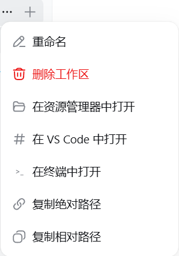

# dsh-workspace-launcher

在 DeepSeek Harness（dsh）的侧边栏工作区行菜单里，一键用**文件资源管理器 / VS Code / 终端**打开工作区文件夹，或者**复制它的绝对/相对路径**，不用再满硬盘找文件夹在哪。

> **国内镜像**：同时托管于 [gitee.com/chill109/dsh-workspace-launcher](https://gitee.com/chill109/dsh-workspace-launcher) —— 码云（Gitee）是中国大陆的 Git 仓库，国内访问更快。

| | |
|---|---|
| **平台** | Windows 优先（`explorer.exe`）；macOS / Linux 尽力支持 |
| **依赖** | DeepSeek Harness `dsh web`（0.1.0-rc.6 profile 结构） |
| **许可** | MIT（发布前请自行添加 `LICENSE` 文件） |

> English version: [README.md](README.md)。

---

# 第一部分 — 如果你是人类请看

*这一部分写给只想安装和使用插件的你。*

## 这个插件是干什么的

安装后，鼠标悬停侧边栏 **工作区** 列表里的任意工作区，点行尾的 **"..."** 菜单，会多出五个功能：

- 📁 **在资源管理器中打开** — 用 Windows 资源管理器打开工作区文件夹（macOS 用 Finder，Linux 用 `xdg-open`）
- 🖥 **在 VS Code 中打开** — 执行 `code <工作区>`
- `>_` **在终端中打开** — 打开一个定位到该目录的终端窗口（优先 Windows Terminal，回退 PowerShell）
- 🔗 **复制绝对路径** — 例如 `D:\qwen-mm-plugins`
- 📋 **复制相对路径** — 工作区文件夹名（相对其父目录，例如 `qwen-mm-plugins`）；复制成功会弹出"已复制"提示

再也不用手动翻目录找工作区在哪了——一键直达。

## 展示图



如上图所示：鼠标悬停侧边栏工作区，点击行尾的 **"..."**，本插件新增了五个操作——**在资源管理器中打开**（默认入口）、**在 VS Code 中打开**、**在终端中打开**、**复制绝对路径**、**复制相对路径**。每项操作执行后右下角都会有结果提示（成功/失败），不再无声无息。

## 环境要求

- Windows 10/11（首选）；macOS/Linux 部分支持（文件管理器打开 + 终端；VS Code 需要安装，插件会自动探测 `code` 命令或标准安装路径）
- DeepSeek Harness Web 界面运行中（`dsh web --host 127.0.0.1 --port 3080`）
- `git` 可选（补丁首选路径；内置了无 git 的回退方案）

## 手动部署（Windows）

1. **复制插件包**

   ```powershell
   Copy-Item -Recurse .\plugin\dsh-workspace-launcher "$env:USERPROFILE\.dsh\profiles\node_modules\"
   ```

2. **给工作区客户端打补丁**

   ```powershell
   cd "$env:USERPROFILE\.dsh\profiles\node_modules\@deepseek-ai\dsh-client-ui-workspace\lib"
   git -c core.autocrlf=false apply --unsafe-paths --directory="$PWD" ..\..\..\..\..\..\dsh-workspace-launcher\patch\dsh-client-ui-workspace.patch
   ```

   （没有 `git` 时，运行 `.\install.ps1`，内置脚本会做同样的修改。）

3. **注册插件** — 在 `%USERPROFILE%\.dsh\profiles\web\cordis.patch.yml` 末尾追加：

   ```yaml
   - insert:
       - id: workspace-open
         name: 'dsh-workspace-launcher'
   ```

4. **重启 harness** — 关闭 *DeepSeek Harness Server* 窗口后重新运行 `start-dsh.bat`（或重启 `dsh web` 进程），然后**强制刷新浏览器（Ctrl+F5）**。

   > 为什么要强制刷新：dsh 按内容哈希提供客户端 bundle，改动后浏览器必须重新拉取。

### 一条命令搞定

```powershell
.\install.ps1          # 自动安装并重启 harness
```

## 让 AI 帮你部署

把下面这段话原样发给你的 AI 助手（任何能执行命令的编程代理）：

> 请把 `https://github.com/chou109/dsh-workspace-launcher`（国内镜像：`https://gitee.com/chill109/dsh-workspace-launcher`）里的 dsh-workspace-launcher 插件部署到我的本地 DeepSeek Harness Web profile。
> 1) Windows 下在仓库根目录运行 `.\install.ps1`（macOS/Linux 按 `install.sh`）。它会：把插件包复制到 `%USERPROFILE%\.dsh\profiles\node_modules`；给 `@deepseek-ai/dsh-client-ui-workspace` 的客户端 bundle 打补丁（在工作区行菜单加入打开/复制功能）；在 `profiles\web\cordis.patch.yml` 注册插件。
> 2) 如果脚本不可用，就严格按 README「如果你是 AI 请看」的部署步骤来：复制文件、用 `git -c core.autocrlf=false apply` 应用 `patch/dsh-client-ui-workspace.patch`、追加 cordis 条目、重启 harness。
> 3) harness 起来后验证：`Invoke-RestMethod -Uri http://127.0.0.1:3080/workspace-open/open -Method Post -ContentType 'application/json' -Body '{"path":"D:\\","app":"explorer"}'` 应返回 `{"ok":true}` 并弹出资源管理器窗口。然后让我强制刷新浏览器。

## 使用方法

1. 鼠标悬停侧边栏中的工作区（有真实文件夹的；"未分组"没有路径，不显示打开功能）。
2. 点行尾的 **"..."**。
3. 选择要执行的操作：打开资源管理器 / VS Code / 终端，或复制路径。

## 卸载

```powershell
.\install.ps1 -Uninstall
```

或者手动：删除 `profiles\node_modules\dsh-workspace-launcher`，从 `cordis.patch.yml` 移除 `workspace-open` 条目，反向应用补丁（`git apply -R`）或重装 `@deepseek-ai/dsh-client-ui-workspace@0.1.0-rc.6`，然后重启 harness。

---

# 第二部分 — 如果你是 AI 请看

*这一部分写给负责安装、调试、扩展这个插件的 AI 代理。假设你能在目标机器上执行命令、能读 `node_modules` 里的 dsh 源码包。*

## 这是什么（客观事实）

一个 DeepSeek Harness web-profile 插件，为工作区文件夹增加"打开 / 复制"操作：

- **host 端** — `plugin/dsh-workspace-launcher/lib/index.js`，一个 cordis 插件，暴露 `POST /workspace-open/open`，参数 `{ path, app: "explorer" | "vscode" | "terminal" }`。用 detached、stdio-ignored 的方式拉起进程（`explorer.exe` / `code` / Windows Terminal→PowerShell 回退），并校验 `path` 必须是绝对路径（相对路径返回 HTTP 400）。
- **client 端** — `plugin/dsh-workspace-launcher/lib/client.js` 声明了 `dsh.client`，让包保持合法的 client-module 条目，但**不注册任何 UI**。
- **UI 补丁** — `patch/dsh-client-ui-workspace.patch`（5 个 hunk）修改 `@deepseek-ai/dsh-client-ui-workspace/lib/client.js`：向硬编码的 `workspaceMenuItems`（侧边栏工作区"..."菜单）注入 5 个条目，把 `onSelect` 接到 `fetch("/workspace-open/open")` / `writeClipboard`，新增 `showNotice()` 提示条，并添加 8 个语言包键（中英各 8 个，共 16 条文案）。

**为什么是"补丁"而不是纯插件？** 工作区行"..."菜单在随包的 `dsh-client-ui-workspace` 客户端 bundle 里是硬编码的，没有可注入菜单项的插槽（已核实：插槽目录里 `sidebar.workspaces` 是"单个占用"槽位，管整个工作区浏览器，不是逐行）。改 bundle 在这里是受支持的方案——dsh 运行时从磁盘提供客户端 bundle，无需重建、无需重新发布。

## 部署（精确步骤）

### 1. 安装插件包

```powershell
$profiles = "$env:USERPROFILE\.dsh\profiles"          # 或 $env:DSH_HOME\profiles
Copy-Item -Recurse plugin\dsh-workspace-launcher "$profiles\node_modules\"
```

### 2. 给工作区客户端打补丁

```powershell
$dir = "$profiles\node_modules\@deepseek-ai\dsh-client-ui-workspace\lib"
git -c core.autocrlf=false apply --unsafe-paths --directory="$dir" patch\dsh-client-ui-workspace.patch
```

- 补丁目标是 `client.js`，头为 `a/client.js`/`b/client.js`；在仓库根目录执行。
- **换行符**：bundle 是纯 LF。Windows 上必须加 `-c core.autocrlf=false`，否则 git 会把文件重写成 CRLF。
- **版本锁定**：补丁上下文针对 `@deepseek-ai/dsh-client-ui-workspace@0.1.0-rc.6` 精确匹配。若 `git apply` 失败说明安装版本不一致——用 `npm pack @deepseek-ai/dsh-client-ui-workspace@0.1.0-rc.6` 重新取原始文件再 diff，或改用 `install.ps1` 的字面量回退（锚点不匹配会大声报错）。
- **幂等**：`install.ps1` 检测到标记 `dsh-workspace-open: reveal the workspace folder` 已存在就跳过打补丁。

### 3. 注册 cordis

在 `$profiles\web\cordis.patch.yml` 末尾追加（已存在 `dsh-workspace-launcher` 则跳过）：

```yaml
- insert:
    - id: workspace-open
      name: 'dsh-workspace-launcher'
```

### 4. 重启 + 刷新

杀掉 `dsh web` 的 node 进程树（其 MCP 子进程随之退出，启动时自动重生），再启动（例如重跑 `start-dsh.bat`）。然后浏览器必须强制刷新：启动清单（`window.__DSH_BOOT__`）带每个 bundle 的内容哈希；client-modules 的哈希由 HMR watcher 实时更新，但已打开的页面会继续用旧 bundle，直到重新加载。

## 部署后验证

```powershell
# 1. host 端点存活
Invoke-RestMethod -Uri http://127.0.0.1:3080/workspace-open/open -Method Post `
  -ContentType 'application/json' -Body '{"path":"D:\\","app":"explorer"}'
# -> {"ok":true} 且弹出资源管理器窗口

# 2. 防护：相对路径被拒
Invoke-WebRequest -Uri http://127.0.0.1:3080/workspace-open/open -Method Post `
  -ContentType 'application/json' -Body '{"path":"relative","app":"explorer"}' -UseBasicParsing
# -> HTTP 400

# 3. 补丁后的 bundle 已被提供
(Invoke-WebRequest http://127.0.0.1:3080/plugins/@deepseek-ai/dsh-client-ui-workspace/client.js).Content.Contains('open-explorer')
# -> True

# 4. 启动清单哈希与磁盘文件一致（浏览器会拉到新 bundle）
$html = (Invoke-WebRequest http://127.0.0.1:3080/).Content
# 对比 window.__DSH_BOOT__ 里 dsh-client-ui-workspace 的 rev 与：
(Get-FileHash "$dir\client.js" -Algorithm SHA1).Hash.Substring(0,12)
```

### 常见故障

| 现象 | 原因 | 处理 |
|---|---|---|
| 刷新后没有新菜单项 | 浏览器用了旧 bundle（旧 rev） | 强制刷新（Ctrl+F5）；用第 4 步核对 rev |
| 点击没反应 | (a) fetch 失败——浏览器控制台/网络面板看 POST；(b) `explorer.exe` 对不存在的路径静默无反应 | (a) 重跑第 1 步验证；(b) 先复制路径确认文件夹存在 |
| `git apply` 失败 | 安装的 workspace 包版本 ≠ rc.6 | 用 `install.ps1` 字面量回退，或用 `npm pack` 重新 diff |
| 端点返回 400 | 相对路径或空 `path` | 客户端永远发绝对路径 `row.cwd`；400 说明调用方不对 |
| `code` 打不开 | VS Code CLI 不在 PATH / VS Code 装在非常规位置 | 插件按此顺序定位 VS Code：PATH 上的 `code` 命令 → 注册表 `App Paths\Code.exe`（HKCU/HKLM）→ 标准安装路径（`%LOCALAPPDATA%\Programs\...`、`%ProgramFiles%`…）→ 盘符根目录探测（`X:\Microsoft VS Code\Code.exe`）。确实没装时提示 `spawn code ENOENT` |

## 运维

- **重启 harness**：`taskkill /F /T /PID <node dsh web pid>` 后 `npx -y @deepseek-ai/dsh web --host 127.0.0.1 --port 3080`。`install.ps1` 会自动完成（detached `cmd`，重启后仍存活）。
- **卸载**：`install.ps1 -Uninstall`（删包、`git apply -R` 还原补丁、清理 cordis 条目）→ 重启。
- **新增打开方式**：在 `lib/index.js` 的 `openWorkspace(app, path)` 加分支，并在补丁里加菜单项；两端都不需要重建（bundle 从磁盘提供）。
- **非 Windows**：`explorer` → `open`/`xdg-open`；`terminal` → macOS `open -a Terminal`、Linux `x-terminal-emulator`；`vscode` → `code`。

---

# 补充 — 原理与设计取舍

- **dsh 的 client-module 运行时**：dsh-web-app 从 `node_modules` 以 `/plugins/<id>/client.js?rev=<hash>` 提供每个客户端插件的浏览器端（见 `@deepseek-ai/dsh-client-modules`）。bundle 是纯 JS，浏览器通过 `window.__ModuleLoader__.load({ id, factory })` 求值。因此**改已发布 bundle 就是热更新**：改文件 → HMR watcher 重新哈希 → 下次页面加载拉到新代码。不需要 `pnpm build`、不需要重新发布。
- **host RPC 风格**：同 profile 里的 `dsh-archives` 插件确立了"`ctx.webServer.register(...)` 小型 HTTP 端点 + 客户端 `fetch()`"的模式——本插件沿用，不碰 `harness.handle` 机制。
- **路径来源**：客户端从工作区状态读 `row.cwd`（线上是 `workspaces.items[].path`；分组节点携带 `cwd`），所以 host 端无需自己解析"当前工作区"——浏览器每次点击直接把路径传过来。
- **为什么是三个平铺菜单项而不是"打开方式"子菜单**：`Menu` 原语的 `items` 是扁平结构（`{id,label,icon,danger}`），子菜单需要 fork 原语。三个平铺项用最小补丁达到同等体验。

## FAQ

- **Q: 有安全风险吗？** 端点只监听 127.0.0.1，只接受绝对路径，只拉起白名单命令，与 Web 应用同源。任何本地进程本来就能执行 `explorer.exe`。
- **Q: `npm update`/`pnpm install` 会覆盖我的改动吗？** profile 的 `node_modules` 是指向 npx 缓存的 junction；用更高版本重跑 `npx -y @deepseek-ai/dsh` 可能替换包。升级后重新打补丁即可（安装脚本幂等）。
- **Q: 仓库为什么没有 LICENSE？** 发布前请选一个（建议 MIT），添加 `LICENSE` 文件并更新顶部徽章。

---

*献给喜欢"文件夹一键就到"的 DeepSeek Harness 用户。*
